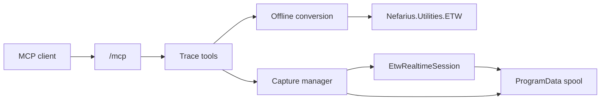

# Architecture

Vestigo is one ASP.NET Core process. It hosts the official MCP Streamable HTTP endpoint at `/mcp` in stateless mode and a Windows service named `Vestigo`.

Offline conversion scans or decodes `.etl` files and writes a bounded JSON or NDJSON file. Realtime capture creates a `Vestigo-` session, enables WPP providers, and appends decoded events to a spool. Clients page that spool with `read_capture`; the MCP call itself does not stream for the life of the trace.

The decoding and symbol-server behavior comes from `Nefarius.Utilities.ETW`. Vestigo does not copy that implementation. PDB and TMF loading, `_NT_SYMBOL_PATH` parsing, cache lookup, GUID/age checks, and symbol-server download are package APIs in `Nefarius.Utilities.ETW.Symbols`.

On startup Vestigo stops only session names previously recorded in its own `owned-sessions.json` file and only when they start with `Vestigo-`. Shutdown stops every capture this process still owns.

Vestigo does not support the NT Kernel Logger and does not write a raw ETL recording. A UI is not part of this release; if one is added later it must use MudBlazor.

## Modules

Features are `VestigoModule` classes listed in `ModuleRegistry`. A module contributes services, MCP tool types, and optional HTTP endpoints, and is switched with `Vestigo:Modules:<Name>:Enabled`. Current modules: `Trace` (the WPP and ETW tools below) and `Jobs` (background jobs with paged output, wait, and cancel), `Environment` (machine, user, and process environment variables), `Logs` (tail and incremental reads of text files) and `EventLog` (Windows event log channels and `.evtx` files).

File-system access for new modules goes through `RootPolicy`: named roots with `Read`, `Write` and `Execute` flags and the same link-following canonicalization as the trace path policy. Long operations run as jobs so an MCP call stays short.

The `Environment` module keeps registry access behind `IEnvironmentStore`; list editing and validation live in `EnvironmentService` and are unit-tested with a fake store. User scope resolves the console user with `WTSGetActiveConsoleSessionId`, `WTSQueryUserToken` and the token SID (CsWin32, `server/NativeMethods.txt`), then opens `HKU\<sid>\Environment`. Persistent changes broadcast `WM_SETTINGCHANGE` ("Environment") with `SendMessageTimeout`. `Logs` uses the pure `TextTailer`, and `EventLog` builds its XPath in the pure `EventLogQueryBuilder`.
