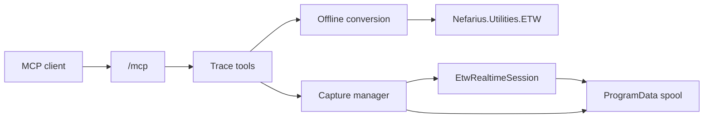

# Architecture

Vestigo is one ASP.NET Core process. It hosts the official MCP Streamable HTTP endpoint at `/mcp` in stateless mode and a Windows service named `Vestigo`.

Offline conversion scans or decodes `.etl` files and writes a bounded JSON or NDJSON file. Realtime capture creates a `Vestigo-` session, enables WPP providers, and appends decoded events to a spool. Clients read that spool with `read_capture`. The server is stateless HTTP and cannot push, so live following is a long-poll: a read with `waitSeconds` parks on a per-job signal that the reader sets after every flushed event and when the job ends. The spool uses exact `\n`-terminated lines with a sparse byte-offset checkpoint every 1024 events, so reads seek instead of rescanning. `attach_etw_session` creates a job in `Attached` mode that consumes an external session by name; it is excluded from the owned-sessions file and from orphan cleanup, and stopping it only cancels Vestigo's consumer.

The decoding and symbol-server behavior comes from `Nefarius.Utilities.ETW`. Vestigo does not copy that implementation. PDB and TMF loading, `_NT_SYMBOL_PATH` parsing, cache lookup, GUID/age checks, and symbol-server download are package APIs in `Nefarius.Utilities.ETW.Symbols`.

On startup Vestigo stops only session names previously recorded in its own `owned-sessions.json` file and only when they start with `Vestigo-`. Shutdown stops every capture this process still owns.

Vestigo does not support the NT Kernel Logger and does not write a raw ETL recording. A UI is not part of this release; if one is added later it must use MudBlazor.

## Services module

Tool logic (name validation, protected-name refusal, wait loops and timeouts, result mapping) lives in `ServiceTools` and talks to the Service Control Manager only through `IServiceControl`, so unit tests use a fake. `WindowsServiceControl` is the real implementation: `ServiceController` for enumeration (`GetServices`, `GetDevices`), start, stop and dependents; the service registry keys for start type, image path, account, dependencies and error control; CsWin32 (`QueryServiceStatusEx`, `ChangeServiceConfig`) for the process id, exit codes and start type changes. Driver service creation and removal go through `INefconRunner`, never through free-form arguments.

## Modules

Features are `VestigoModule` classes listed in `ModuleRegistry`. A module contributes services, MCP tool types, and optional HTTP endpoints, and is switched with `Vestigo:Modules:<Name>:Enabled`. Current modules: `Trace` (the WPP and ETW tools below), `Jobs` (background jobs with paged output, wait, and cancel), `Processes` (run, list, close, and kill processes; opt-in, requires `Jobs` and API tokens), `Files` (root-confined file tools plus authenticated `PUT`/`GET /files/{root}/{path}` transfer endpoints), `Environment` (machine, user, and process environment variables), `Logs` (tail and incremental reads of text files), `EventLog` (Windows event log channels and `.evtx` files), `Services` (Windows services and kernel drivers; enabled by default) and `Devices` (driver install, device nodes, class filters, and device state; opt-in), and `RemoteDebugger` (install and run `msvsmon.exe`; opt-in, depends on `Jobs` and `Processes`). A module can declare `Dependencies`, and startup fails when an enabled module needs a disabled one. The `Files` module keeps its replace and locked-file logic in `FileDeployer`; reboot-time operations go through `IRebootScheduler`, implemented with CsWin32 `MoveFileEx`, and signature checks use `WinVerifyTrust`.

File-system access for new modules goes through `RootPolicy`: named roots with `Read`, `Write` and `Execute` flags and the same link-following canonicalization as the trace path policy. Long operations run as jobs so an MCP call stays short.

The `Environment` module keeps registry access behind `IEnvironmentStore`; list editing and validation live in `EnvironmentService` and are unit-tested with a fake store. User scope resolves the console user with `WTSGetActiveConsoleSessionId`, `WTSQueryUserToken` and the token SID (CsWin32, `server/NativeMethods.txt`), then opens `HKU\<sid>\Environment`. Persistent changes broadcast `WM_SETTINGCHANGE` ("Environment") with `SendMessageTimeout`. `Logs` uses the pure `TextTailer`, and `EventLog` builds its XPath in the pure `EventLogQueryBuilder`.

### Processes

`ProcessTools` resolves paths through `RootPolicy` (`Execute` for programs, `Read` for working directories), plans the launch (`LaunchPlanner`: `.ps1` host selection, validation, `CommandLineBuilder` quoting) and starts a job whose work calls `IProcessLauncher`. `ProcessLauncher` has two paths. The service path runs the child through CliWrap (`Cli.Wrap`, argument array, no shell string) with stdout and stderr piped into the job spool; cancelling kills the whole process tree. The interactive path runs as the console user: `WTSGetActiveConsoleSessionId` and `WTSQueryUserToken` (plus `TokenLinkedToken` for `elevated`), `CreateEnvironmentBlock`, then `CreateProcessAsUser` on `winsta0\default` with only the spool file and NUL in a `PROC_THREAD_ATTRIBUTE_HANDLE_LIST`. The process starts suspended, joins a job object with `KILL_ON_JOB_CLOSE`, then resumes. The approach is ported from SignRelay's interactive launcher through CsWin32 (`server/NativeMethods.txt`).

Window closing needs the target desktop, so `close_app` runs `Vestigo.exe --session-helper close-window` through the interactive launcher. `Program.cs` handles that flag before the web host is built; the helper uses `EnumWindows`, `GetWindowThreadProcessId` and `PostMessage`, prints JSON, and exits.

### RemoteDebugger

`RemoteDebuggerPlanner` holds the pure logic: version, architecture and auth parsing, installer URL selection, `msvsmon` argument building, start validation, the Authenticode signer-subject check and command-line port parsing. `MsvsmonLocator` discovers `msvsmon.exe` through an `IMsvsmonProbe` (standalone path, full IDE editions, `vswhere`, HKLM uninstall entries, `ExtraSearchPaths`), so it can be tested with fake results. `RemoteDebuggerService` downloads through `IHttpClientFactory` inside a `JobManager` job, verifies the file with `AuthenticodeVerifier` (`WinVerifyTrust` through CsWin32), and starts, tracks and stops monitors through `IProcessLauncher`, `AppCloser` and `ProcessControl`.

## Devices infrastructure

`Vestigo.Devices` holds always-on device and driver infrastructure that modules build on; it is not a module itself; the `Devices` module exposes it as MCP tools. `INefconRunner` wraps the bundled [nefcon](https://github.com/nefarius/nefcon) CLI (`tools\nefconc.exe` next to `Vestigo.exe`, or `Vestigo:Devices:NefconPath`). Each operation (driver install and uninstall, device node create and remove, class filters, filter drivers, `[DefaultInstall]` INFs, driver services, driver store purge, delete on reboot) builds a fixed argument list; callers never pass free-form arguments. Invocations run one at a time with a timeout and the process tree is killed on timeout or cancellation. The result carries the exit code, the output tail, and `RebootRequired` (nefcon exit code 3010, which counts as success). Process execution uses [CliWrap](https://github.com/Tyrrrz/CliWrap) (graceful stop, then process-tree kill after a short grace period) and sits behind `INefconProcess` so tests verify argument lists without running nefcon. The service account must be elevated, as nefcon fails with exit code 1 otherwise.

The Devices module (DeviceTools) adds tools on top of INefconRunner and IDeviceControl. IDeviceControl wraps Nefarius.Utilities.DeviceManagement 6.2.0 (restart, enable, disable by instance ID; device enumeration and lookup, class filters, and driver store listing) and converts the library's exceptions to DeviceControlException with stable codes, so tool logic is tested with fakes. INF paths are resolved through RootPolicy with Read access before they reach nefcon. Queries run in-process and never start nefcon.
