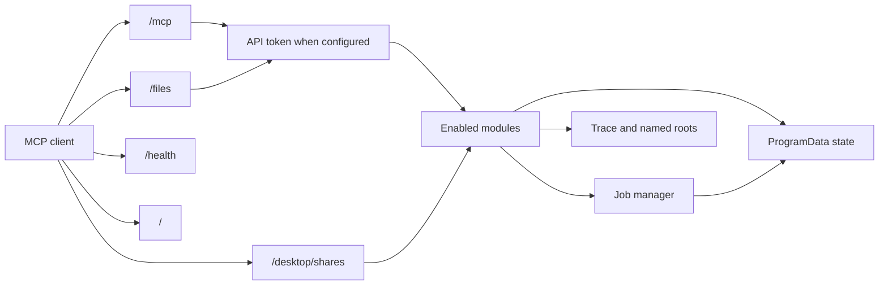

# Architecture

Vestigo is one ASP.NET Core process. It hosts the official MCP Streamable HTTP endpoint at `/mcp` in stateless mode and a Windows service named `Vestigo`.

Offline conversion scans or decodes `.etl` files and writes a bounded JSON or NDJSON file. Realtime capture creates a `Vestigo-` session, enables WPP providers, and appends decoded events to a spool. Clients read that spool with `read_capture`. The server is stateless HTTP and cannot push, so live following is a long-poll: a read with `waitSeconds` parks on a per-job signal that the reader sets after every flushed event and when the job ends. The spool uses exact `\n`-terminated lines with a sparse byte-offset checkpoint every 1024 events, so reads seek instead of rescanning. `attach_etw_session` creates a job in `Attached` mode that consumes an external session by name; it is excluded from the owned-sessions file and from orphan cleanup, and stopping it only cancels Vestigo's consumer.

The decoding and symbol-server behavior comes from `Nefarius.Utilities.ETW`. Vestigo does not copy that implementation. PDB and TMF loading, `_NT_SYMBOL_PATH` parsing, cache lookup, GUID/age checks, and symbol-server download are package APIs in `Nefarius.Utilities.ETW.Symbols`. Empty trace-root lists use the protected `<settings>\traces` folder, also exposed as the named root `traces`. `resolve_binary_symbols` reads CodeView identities through that package and the same store. Symbol-server credentials stay in Vestigo (`SymbolServerAuthHandler`).

On startup Vestigo stops only session names previously recorded in its own `owned-sessions.json` file and only when they start with `Vestigo-`. Shutdown stops every capture this process still owns.

Vestigo does not support the NT Kernel Logger and does not write a raw ETL recording. A UI is not part of this release; if one is added later it must use MudBlazor.

## Services module

Tool logic (name validation, protected-name refusal, wait loops and timeouts, result mapping) lives in `ServiceTools` and talks to the Service Control Manager only through `IServiceControl`, so unit tests use a fake. `WindowsServiceControl` is the real implementation: `ServiceController` for enumeration (`GetServices`, `GetDevices`), start, stop and dependents; the service registry keys for start type, image path, account, dependencies and error control; CsWin32 (`QueryServiceStatusEx`, `ChangeServiceConfig`) for the process id, exit codes and start type changes. Driver service creation and removal go through `INefconRunner`, never through free-form arguments.

## ScheduledTasks module

`ScheduledTaskTools` holds validation, the `AllowChanges` gate, protected-path refusal, and wait loops, and talks to Task Scheduler only through `IScheduledTaskService`, so unit tests use a fake. `ComScheduledTaskService` is the real implementation: late-bound COM on `Schedule.Service` (the `ITaskService` interfaces are dual IDispatch with VARIANT arguments, so no extra package or hand-written interop is needed), with actions, triggers, and the principal parsed from the task definition XML. COM failures map to stable codes (`not_found`, `access_denied`, `already_running`, `not_running`, `task_disabled`). `ScheduledTaskHistoryReader` reads `Microsoft-Windows-TaskScheduler/Operational` through `EventLogReader` and does not depend on the `EventLog` module.
## Software module

`SoftwareTools` reads entries through `ISoftwareInventory` (`RegistrySoftwareInventory` uses `Microsoft.Win32.Registry` in read-only mode) and builds commands with the pure `UninstallPlanner` after `InstallerDetector` classified the entry. The uninstall runs as a `JobManager` job through `IUninstallRunner`, implemented with the same CliWrap-based service runner as `Processes`, so unit tests use a fake inventory and runner.

## Modules

Features are `VestigoModule` classes listed in `ModuleRegistry`. A module contributes services, MCP tool types, and optional HTTP endpoints, and is switched with `Vestigo:Modules:<Name>:Enabled`. Current modules: `Trace` (the WPP and ETW tools below), `Jobs` (background jobs with paged output, wait, and cancel), `Processes` (run, list, close, and kill processes; opt-in, requires `Jobs`), `Files` (root-confined file tools plus `PUT`/`GET /files/{root}/{path}` transfer endpoints that accept an API token like `/mcp` or a one-time ticket minted by `FileLinkIssuer` and tracked in `FileTicketStore`), `Environment` (machine, user, and process environment variables), `System` (host Windows version, UEFI, Secure Boot, test signing, UAC, code-integrity settings, boot state, and logon sessions; enabled by default; boot-configuration writes gated by `Vestigo:System:AllowBootConfigurationChanges` and UAC writes gated by `Vestigo:System:AllowUacChanges`), `Logs` (tail, incremental reads and ripgrep search of text files), `EventLog` (Windows event log channels and `.evtx` files), `Desktop` (window and display enumeration, gated screenshots, short-lived `/desktop/shares` preview links, and the `inspect_screen` and `find_on_screen` perception tools; opt-in), `Input` (gated `send_input` mouse and keyboard injection; opt-in, requires `Desktop`), `Audio` (audio endpoint inventory and gated default-device switch; opt-in), `Services` (Windows services and kernel drivers; enabled by default), `ScheduledTasks` (scheduled task inventory, history, and gated run, stop, enable, disable, and delete; enabled by default), `Software` (installed software inventory and gated silent uninstall; depends on `Jobs`), `Devices` (driver install, device nodes, class filters, and device state; opt-in), `RemoteDebugger` (install and run `msvsmon.exe`; opt-in, depends on `Jobs` and `Processes`), `DebugOutput` (Win32 `OutputDebugString` capture through bundled DebugViewConsole; opt-in), `Diagnostics` (PE inspection, Authenticode and catalog signatures, loaded-module lists, SetupAPI history, device problem codes, graphics adapters, process connections, media capabilities, Windows Error Reporting metadata, and gated capture probes, network probes, audio playback, and process dumps; opt-in), `WindowsServicing` (read-only Windows Update, reboot, CBS, log, storage and file-locker diagnostics; opt-in, requires Jobs), `Registry` (allow-listed registry reads with an explicit 32-bit or 64-bit view; opt-in), `Updates` (signed Buildbot feed check and gated silent self-update; enabled by default; `start_self_update` gated by `Vestigo:Updates:AllowSelfUpdate`), and `Power` (read-only AC, battery, active scheme, platform capabilities, and AC/DC sleep policy; enabled by default). A module can declare `Dependencies`, and startup fails when an enabled module needs a disabled one. Enabling `Processes`, `Devices`, or `RemoteDebugger` without `ApiTokens` is allowed and logs a startup `SECURITY WARNING`. `Services` is named in that warning only when the server binds beyond loopback, `ScheduledTasks:AllowChanges` only when the ScheduledTasks module is also enabled, `Software:AllowUninstall` only when the Software module is also enabled, `System:AllowBootConfigurationChanges` or `System:AllowUacChanges` only when the System module is also enabled, `Updates:AllowSelfUpdate` only when the Updates module is also enabled, `Desktop` is named for information disclosure of window titles (and screenshots when `Desktop:AllowScreenshots` is also on), `Input:AllowInput` only when the Input module is also enabled, `Audio` is named for audio devices and the processes using them (and for changing defaults when `Audio:AllowSetDefault` is also on), `DebugOutput` is named separately for its machine-wide debug-output reader, and `Diagnostics` is named for PE metadata, signature checks, loaded modules, SetupAPI logs, device problem codes, graphics adapters, TCP and UDP bindings owned by a process, Media Foundation video encoders and camera formats, audio format checks, and Windows Error Reporting report metadata (online revocation only when `Diagnostics:AllowOnlineRevocation` is also on, capture probes only when `Diagnostics:AllowCaptureProbes` is also on, network probes only when `Diagnostics:AllowNetworkProbes` is also on, audio playback only when `Diagnostics:AllowAudioPlayback` is also on, and process dumps only when `Diagnostics:AllowProcessDumps` is also on). `RegistryPathPolicy` canonicalizes `HKLM`, `HKU`, and `HKCU` paths and applies deny-wins prefix matching before `WindowsRegistryStore` opens a key. The store is behind `IRegistryStore` so the tools are tested with a fake. `HKCU` uses the same console-user SID lookup as user environment variables. The `Files` module keeps its replace and locked-file logic in `FileDeployer`; reboot-time operations go through `IRebootScheduler`, implemented with CsWin32 `MoveFileEx`, and signature checks use `WinVerifyTrust`. `/files` is anonymous while `ApiTokens` is empty. The `Updates` module fetches and verifies the feed in `UpdateFeedClient` (`minisign-net` plus `Nefarius.Vicius.Abstractions`), reads the installed version through `IInstalledVersionSource`, and launches the packaged updater through `ISelfUpdateRunner` with `Process.Start` (no kill-on-close job object) so the service can stop while the temporary Vicius copy finishes the MSI.

File-system access for new modules goes through `RootPolicy`: named roots with `Read`, `Write` and `Execute` flags and the same link-following canonicalization as the trace path policy. Long operations run as jobs so an MCP call stays short.

The `Environment` module keeps registry access behind `IEnvironmentStore`; list editing and validation live in `EnvironmentService` and are unit-tested with a fake store. User scope resolves the console user with `WTSGetActiveConsoleSessionId`, `WTSQueryUserToken` and the token SID (CsWin32, `server/NativeMethods.txt`), then opens `HKU\<sid>\Environment`. Persistent changes broadcast `WM_SETTINGCHANGE` ("Environment") with `SendMessageTimeout`. The `System` module reaches `Nefarius.Utilities.WindowsVersion` and the UAC policy registry only through `ISystemPlatform` (`WindowsVersionPlatform`); `SystemService` maps failed probes to null fields and enforces the boot-configuration and UAC write gates. `get_boot_state` reads uptime, an approximate UTC boot time, Fast Startup configuration, safe mode, and the pending-rename count through `IBootStatePlatform` (`WindowsBootStatePlatform`). `HiberbootEnabled` is configuration only and does not identify a hybrid boot. The count does not include the queued paths. Logon sessions are read through `ISessionPlatform` (`WindowsSessionPlatform`). `list_logon_sessions` and `get_logon_session` enumerate Terminal Services sessions, and client names and addresses stay off the log unless the caller asks for them. `ConsoleSession` is the one console-session and user-token lookup shared by interactive process launch and the console-user environment hive. A missing console user keeps `no_interactive_session` or `user_not_available` and adds `reason`: `nobody_logged_on`, `only_disconnected_sessions`, `session_0_only`, or `console_session_has_no_token`. Process launch still refuses session 0. The environment store still opens a token for session 0. Access denied stays `token_unavailable` or `access_denied` and does not get one of those reasons. `Logs` uses the pure `TextTailer`. `read_json_path` and `get_json_summary` parse one UTF-8 document and let `JsonPathEvaluator` allow-list JsonPath.Net (RFC 9535) segments down to names, indexes, and one trailing wildcard. `JsonTools` checks the file length before reading and does not log matched values. `EventLog` builds its XPath in the pure `EventLogQueryBuilder`. `Logs` also runs the bundled ripgrep for `search_text`: `SearchTools` resolves the path through `RootPolicy`, `RipgrepArguments` builds the fixed argument list (`--json`, `--no-config`, `--no-follow`; the pattern after `-e`, the path after `--`), `RipgrepSearcher` verifies the pinned digest, bounds concurrency, time and result count and kills the process tree when a bound is hit, and `RipgrepOutputParser` turns ripgrep's JSON stream into lines. Process execution uses CliWrap behind `IRipgrepProcess`, so tests use a fake; the real `rg.exe` is exercised when `VESTIGO_TEST_RIPGREP` points at one.

### Power

`PowerTools` reads through `IPowerPlatform` (`WindowsPowerPlatform`). `get_power_state` uses `GetSystemPowerStatus`, `PowerGetActiveScheme`, `CallNtPowerInformation` (`SystemPowerCapabilities`, `LastSleepTime`, `LastWakeTime`), and `QueryInterruptTime`. Last sleep and wake are approximate UTC times from those interrupt-time counters. `get_sleep_configuration` reads AC and DC indices with `PowerReadACValueIndex` and `PowerReadDCValueIndex` for the documented lid, timeout, wake-timer, and hybrid-sleep settings. A missing index stays null. There is no power-scheme write.

### Processes

`ProcessTools` resolves paths through `RootPolicy` (`Execute` for programs, `Read` for working directories), plans the launch (`LaunchPlanner`: `.ps1` host selection, validation, `CommandLineBuilder` quoting) and starts a job whose work calls `IProcessLauncher`. `ProcessLauncher` has two paths. The service path runs the child through CliWrap (`Cli.Wrap`, argument array, no shell string) with stdout and stderr piped into the job spool; cancelling kills the whole process tree. The interactive path runs as the console user: `WTSGetActiveConsoleSessionId` and `WTSQueryUserToken` (plus `TokenLinkedToken` for `elevated`), `CreateEnvironmentBlock`, then `CreateProcessAsUser` on `winsta0\default` with only the spool file and NUL in a `PROC_THREAD_ATTRIBUTE_HANDLE_LIST`. The process starts suspended, joins a job object with `KILL_ON_JOB_CLOSE`, then resumes. The approach is ported from SignRelay's interactive launcher through CsWin32 (`server/NativeMethods.txt`).

Window closing, desktop enumeration, window inspection, window-event capture, window placement, display-layout changes, screenshots, audio endpoint access, capture probes, and audio format probes need the target session, so `close_app`, `list_windows`, `list_displays`, `inspect_window`, `start_window_event_capture`, `set_window_client_rect`, `restore_window_placement`, `snapshot_display_layout`, `start_display_layout_transaction`, `take_screenshot`, `inspect_screen`, `find_on_screen`, `send_input`, `list_audio_endpoints`, `set_default_audio_endpoint`, `probe_capture_support`, and `probe_audio_format` run `Vestigo.exe --session-helper` (`close-window`, `list-windows`, `list-displays`, `inspect-window`, `window-events`, `place-window`, `restore-window`, `snapshot-display-layout`, `apply-display-layout`, `capture-screen`, `inspect-screen`, `send-input`, `list-audio`, `set-default-audio`, `probe-capture`, or `probe-audio-format`) through the interactive launcher. The helper is one dispatcher plus a file per command. `Program.cs` handles that flag before the web host is built; the helper prints JSON and exits. `SessionHelperClient` owns the spool file and JSON contract so `Processes`, `Desktop`, `Audio`, and `Diagnostics` can start the helper without depending on each other. `inspect_window` and window placement also have a service-session path. Window-event capture and display changes are interactive only.

### Desktop

`DesktopTools` lists windows and displays and captures screenshots through `DesktopInventory`. The service path enumerates in-process. Screenshots always use the interactive path. The interactive path launches the session helper as the console user. `WindowEnumerator` walks top-level windows (and children when requested), records parent/owner, physical-pixel bounds under per-monitor DPI awareness, and maps each window to a GDI display. `DisplayTopology` combines `EnumDisplayMonitors` with `QueryDisplayConfig` physical targets and falls back to `EnumDisplayDevices` when the CCD API is unavailable. `includeModes` adds refresh, active mode, rotation, scaling, the source adapter LUID, and advanced color from `DISPLAYCONFIG_GET_ADVANCED_COLOR_INFO`. `ScreenCapture` blits the virtual screen, one display, or a rectangle with GDI (`BitBlt` + `CAPTUREBLT`), or a window with `PrintWindow(PW_RENDERFULLCONTENT)`, then encodes PNG (and a Fant-scaled preview) with WIC. `take_screenshot` is refused unless `Vestigo:Desktop:AllowScreenshots` is true; the helper does not read the machine settings file. An optional `saveTo` path is written through `FileDeployer` after the helper returns the full PNG. `share: true` stores only the downscaled preview in `ScreenshotShareStore` (in memory, SHA-256 ticket digest, at most 16 entries and 32 MiB, 10 minutes, single use) and `ScreenshotShareEndpoint` serves it at `GET /desktop/shares/{id}`. The MCP result keeps the image block for the model and adds a resource link plus `share` metadata telling the client to present the URL.

`inspect_window` is a separate tool. `WindowInspector` checks the HWND, pid and process start time before and after the read. `WindowsWindowInspectionSource` enters per-monitor v2, verifies it, and restores the previous thread context. Each native read is a `FieldResult`. A failed read has no value. Window-event capture is a hosted `WindowEventCaptureManager`. The helper installs one out-of-context WinEvent hook and writes JSON lines. The service validates each line into an `NdjsonSpool` and assigns the sequence numbers. `set_window_client_rect` is `WindowPlacer` over `SetWindowPos`. The service owns restore tokens. Display changes are `DisplayLayoutTransactionManager`: one transaction, a checkpoint written before `SetDisplayConfig`, a lease, and a best-effort restore on startup. The CCD adapter does not create virtual displays.

#### Screen perception and input

`PerceptionTools` (`inspect_screen`, `find_on_screen`) split the work across the process boundary. `Vestigo.exe --session-helper inspect-screen` runs in the console user's session: it captures the full-resolution PNG, walks UI Automation for the windows that overlap the capture (z-order aware, so covered elements are skipped; edit values are never read), and runs `Windows.Media.Ocr`. The service then runs OpenCV through OpenCvSharp in `ScreenAnalyzer`: it downscales to `maxEdge`, adds contour regions only where UI Automation and OCR found nothing, and merges everything in `ElementMerger`. An OCR line is dropped when a named UI Automation element covers it and their text agrees, unless a text search matches the line and not that element. Contour regions are dropped where either source already found something. The merged list is capped at 150 elements, split evenly between UI Automation and OCR, and a source that finds fewer passes its share to the other, with contours filling what remains. `find_on_screen` reserves room for every text match before that cap. The service draws numbered set-of-marks boxes or a coordinate grid, and can diff two captures or run multi-scale template matching. UI Automation uses the CsWin32 COM interfaces directly. A wrapper package would add the `Microsoft.WindowsDesktop.App` runtime as a deployment requirement, which the framework-dependent publish does not carry.

Every inspection is stored in `PerceptionService`'s `CaptureCache` (singleton, at most eight entries, two minutes) under a `captureId`. The record keeps the unannotated working image, how it maps onto the virtual screen, and the elements in physical pixels, so `send_input` can click an `elementId` or an `x,y` taken from the returned image. `InputPlanner` validates the action list and resolves those references to absolute physical pixels before anything reaches the helper. `Vestigo.exe --session-helper send-input` receives the resolved batch as base64 JSON and `InputInjector` replays it with `SendInput` on a per-monitor-DPI-aware thread (absolute virtual-desktop mouse coordinates, `KEYEVENTF_UNICODE` for text), after refusing to act when the input desktop is not the session's default desktop. The `Input` module registers only `send_input`; the gate is `Vestigo:Input:AllowInput`.

### Audio

`AudioTools` lists endpoints and switches defaults through `AudioInventory`. The service path calls `AudioEndpoints` in-process. The interactive path launches the session helper as the console user. Enumeration uses [NAudio.Wasapi](https://github.com/naudio/NAudio) (`MMDeviceEnumerator`) for volume, mute, a short peak-meter sample, sessions, and the current default roles. Switching calls the undocumented `IPolicyConfig.SetDefaultEndpoint` (hand-declared). `AudioTools` refuses the switch unless `Vestigo:Audio:AllowSetDefault` is true; the helper does not read the machine settings file.

### RemoteDebugger

`RemoteDebuggerPlanner` holds the pure logic: version, architecture and auth parsing, installer URL selection, `msvsmon` argument building, start validation, the Authenticode signer-subject check and command-line port parsing. `MsvsmonLocator` discovers `msvsmon.exe` through an `IMsvsmonProbe` (standalone path, full IDE editions, `vswhere`, HKLM uninstall entries, `ExtraSearchPaths`), so it can be tested with fake results. `RemoteDebuggerService` downloads through `IHttpClientFactory` inside a `JobManager` job, verifies the file with `AuthenticodeVerifier` (`WinVerifyTrust` through CsWin32), and starts, tracks and stops monitors through `IProcessLauncher`, `AppCloser` and `ProcessControl`.

### DebugOutput

`DebugOutputManager` runs at most one hash-pinned `DebugViewConsole.exe` as a bounded capture job. Stdout is parsed into NDJSON and appended through `NdjsonSpool` (the same writer, checkpoints, and long-poll used by ETW captures). Clients read with `read_debug_output`. On startup the manager kills only a recorded orphan whose image path matches.

### Diagnostics

`DiagnosticsModule` is opt-in and depends on `Jobs` because `capture_process_dump` is a job. `inspect_binary` reads PE metadata through [PeNet](https://github.com/secana/PeNet) behind `IPeInspector`. `verify_file_signature` and `stat_path` share `ISignatureVerifier` (`WinTrustSignatureVerifier`): embedded `WinVerifyTrust`, then a catalog lookup when the file has no embedded signature. `none` and `cacheOnly` set `WTD_CACHE_ONLY_URL_RETRIEVAL`. `list_process_modules` uses Toolhelp behind `IProcessModuleSource` and aliases paths through `RootPolicy.DescribeRead` after link following. `get_device_install_history` reads the fixed SetupAPI dev logs through `ISetupApiLogSource`. `explain_device_problem` uses `IDeviceControl` registered with `TryAdd`, so device queries work while the Devices module is off, and it consults service, boot-security, and event-log services only when those modules are enabled. `list_graphics_adapters` uses DXGI (`CreateDXGIFactory2`, `IDXGIFactory6`, `DXGI_ADAPTER_DESC3`) behind `IGraphicsInventory` in the service process and matches Display-class nodes by PCI ids. `probe_capture_support` is gated by `AllowCaptureProbes` and runs Desktop Duplication in the session helper. It releases COM and D3D objects in `finally` and never copies pixels. Windows Graphics Capture is `unsupported` because this build does not implement that API (the repository targets `net10.0-windows10.0.19041.0` for `Windows.Media.Ocr`, but capture still uses GDI and Desktop Duplication). `list_process_connections` reads `GetExtendedTcpTable` and `GetExtendedUdpTable` behind `IProcessConnectionSource` and returns remote addresses only when requested. `test_endpoint` is gated by `AllowNetworkProbes` and `AllowedProbeDestinations`, and it resolves, connects, or completes a TLS handshake with certificate validation still enabled. `list_video_encoders` calls `MFTEnumEx` and does not activate the transforms. `list_camera_formats` uses `MFEnumDeviceSources`; a selected source is activated only to read advertised media types and is then shut down. `probe_audio_format` runs WASAPI in the session helper. Format checks do not start the stream. Audible playback requires `AllowAudioPlayback`. `list_crash_reports` reads fixed Windows Error Reporting `Report.wer` files and records dump names and lengths only. `capture_process_dump` is gated by `AllowProcessDumps` and calls `MiniDumpWriteDump` in the service process. It rechecks the process start time, refuses protected and critical processes, and deletes a dump that exceeds `MaxDumpBytes`. It does not upload the file or create a download ticket. The remote-debugger Authenticode check stays a separate Microsoft signer verification.

## Devices infrastructure

`Vestigo.Devices` holds always-on device and driver infrastructure that modules build on; it is not a module itself; the `Devices` module exposes it as MCP tools. `INefconRunner` wraps the bundled [nefcon](https://github.com/nefarius/nefcon) CLI (`tools\nefconc.exe` next to `Vestigo.exe`, or `Vestigo:Devices:NefconPath`). Each operation (driver install and uninstall, device node create and remove, class filters, filter drivers, `[DefaultInstall]` INFs, driver services, driver store purge, delete on reboot) builds a fixed argument list; callers never pass free-form arguments. Invocations run one at a time with a timeout and the process tree is killed on timeout or cancellation. The result carries the exit code, the output tail, and `RebootRequired` (nefcon exit code 3010, which counts as success). Process execution uses [CliWrap](https://github.com/Tyrrrz/CliWrap) (graceful stop, then process-tree kill after a short grace period) and sits behind `INefconProcess` so tests verify argument lists without running nefcon. The service account must be elevated, as nefcon fails with exit code 1 otherwise.

The Devices module (DeviceTools) adds tools on top of INefconRunner and IDeviceControl. IDeviceControl wraps Nefarius.Utilities.DeviceManagement 6.2.0 (restart, enable, disable by instance ID; device enumeration and lookup, class filters, and driver store listing) and converts the library's exceptions to DeviceControlException with stable codes, so tool logic is tested with fakes. INF paths are resolved through RootPolicy with Read access before they reach nefcon. Queries run in-process and never start nefcon.

## Windows servicing module

The opt-in WindowsServicing module is separate from the Vestigo self-updater. RebootPendingService uses a read-only registry seam and preserves unknown sources. WindowsUpdateAgent uses CsWin32-generated WUA COM interfaces with explicit MTA initialization, interface releases and BSTR ownership; ServicingPackageSource uses native DISM package enumeration. NativeDiagnosticWorker serializes WUA, DISM and Restart Manager with a retained slot after timeout/cancellation. Inventory calls spool JSON through JobManager. UpdateDiagnosticsTools composes existing root-confined LogTools and bounded EventLogService queries without requiring those modules to be exposed. FileLockerTools checks a Read root before Restart Manager. See [Windows servicing diagnostics](windows-servicing.md) for contracts, configuration and limitations.

RestartManagerSource uses CsWin32-generated APIs, process structs and constants. ServicingPackageSource retains documented manual DISM-specific declarations because the pinned metadata reports PInvoke001 for its API symbols; shared HRESULT, PCWSTR and SYSTEMTIME types are generated. No generator settings or package versions were changed for this refactor.
