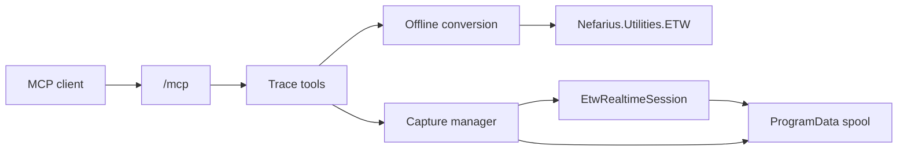

# Architecture

Vestigo is one ASP.NET Core process. It hosts the official MCP Streamable HTTP endpoint at `/mcp` in stateless mode and a Windows service named `Vestigo`.

Offline conversion scans or decodes `.etl` files and writes a bounded JSON or NDJSON file. Realtime capture creates a `Vestigo-` session, enables WPP providers, and appends decoded events to a spool. Clients page that spool with `read_capture`; the MCP call itself does not stream for the life of the trace.

The decoding and symbol-server behavior comes from `Nefarius.Utilities.ETW`. Vestigo does not copy that implementation. PDB and TMF loading, `_NT_SYMBOL_PATH` parsing, cache lookup, GUID/age checks, and symbol-server download are package APIs in `Nefarius.Utilities.ETW.Symbols`.

On startup Vestigo stops only session names previously recorded in its own `owned-sessions.json` file and only when they start with `Vestigo-`. Shutdown stops every capture this process still owns.

Vestigo does not support the NT Kernel Logger and does not write a raw ETL recording. A UI is not part of this release; if one is added later it must use MudBlazor.

## Services module

Tool logic (name validation, protected-name refusal, wait loops and timeouts, result mapping) lives in `ServiceTools` and talks to the Service Control Manager only through `IServiceControl`, so unit tests use a fake. `WindowsServiceControl` is the real implementation: `ServiceController` for enumeration (`GetServices`, `GetDevices`), start, stop and dependents; the service registry keys for start type, image path, account, dependencies and error control; CsWin32 (`QueryServiceStatusEx`, `ChangeServiceConfig`) for the process id, exit codes and start type changes. Driver service creation and removal go through `INefconRunner`, never through free-form arguments.

## Modules

Features are `VestigoModule` classes listed in `ModuleRegistry`. A module contributes services, MCP tool types, and optional HTTP endpoints, and is switched with `Vestigo:Modules:<Name>:Enabled`. Current modules: `Trace` (the WPP and ETW tools below), `Jobs` (background jobs with paged output, wait, and cancel) and `Services` (Windows services and kernel drivers).

File-system access for new modules goes through `RootPolicy`: named roots with `Read`, `Write` and `Execute` flags and the same link-following canonicalization as the trace path policy. Long operations run as jobs so an MCP call stays short.

## Devices infrastructure

`Vestigo.Devices` holds always-on device and driver infrastructure that modules build on; it is not a module and contributes no MCP tools yet. `INefconRunner` wraps the bundled [nefcon](https://github.com/nefarius/nefcon) CLI (`tools\nefconc.exe` next to `Vestigo.exe`, or `Vestigo:Devices:NefconPath`). Each operation (driver install and uninstall, device node create and remove, class filters, filter drivers, `[DefaultInstall]` INFs, driver services, driver store purge, delete on reboot) builds a fixed argument list; callers never pass free-form arguments. Invocations run one at a time with a timeout and the process tree is killed on timeout or cancellation. The result carries the exit code, the output tail, and `RebootRequired` (nefcon exit code 3010, which counts as success). Process execution uses [CliWrap](https://github.com/Tyrrrz/CliWrap) (graceful stop, then process-tree kill after a short grace period) and sits behind `INefconProcess` so tests verify argument lists without running nefcon. The service account must be elevated, as nefcon fails with exit code 1 otherwise.
